  

  
  
  

  
  

---

<h2 align="center">

👨🏻‍💻 Sobre mim 

</h2>

Sou estudante de **Análise e Desenvolvimento de Sistemas** na **FIVJ**, com foco em **Dados e Tecnologia** e ênfase em **Banco de Dados**.

Estou aprofundando meu conhecimento em **Desenvolvimento de Software e Web**, elaborando projetos práticos para consolidar o conteúdo estudado.

Busco evoluir continuamente em programação, análise de dados e resolução de problemas, mantendo disciplina nos estudos. Estou aberto a oportunidades que tragam aprendizado, desafios técnicos e crescimento profissional.

---

<h2 align = "center">
🛠️ Tecnologias e ferramentas
</h2>

  
  
  
  
  
  
  
  
  
  
  

--- 

<h2 align = "center">
💻 Meu setup
</h2>

   
    
   
      
  

--- 

<h2 align="center">
📊 GitHub Stats
</h2>

  

  

  
  

## 🧱 Contribuições

  <picture>
    <source media="(prefers-color-scheme: dark)" srcset="https://raw.githubusercontent.com/LeandroAlmeida77/LeandroAlmeida77/output/github-tetris-dark.svg" />
    <source media="(prefers-color-scheme: light)" srcset="https://raw.githubusercontent.com/LeandroAlmeida77/LeandroAlmeida77/output/github-tetris.svg" />
    
  </picture>

---

<h1 align="center">
🚀 Projetos
</h1>

  <i> Repositórios de Projetos  </i>

🎓 **Projetos Acadêmicos** - Desenvolvidos na Graduação
💻 **Projetos Pessoais** - Aplicações e experimento em prática

---

  <i>🤖 A IA gera o código, mas quem garante que ele funcione é o programador 🧠.</i>

<!-- Rodapé Animado -->

  

